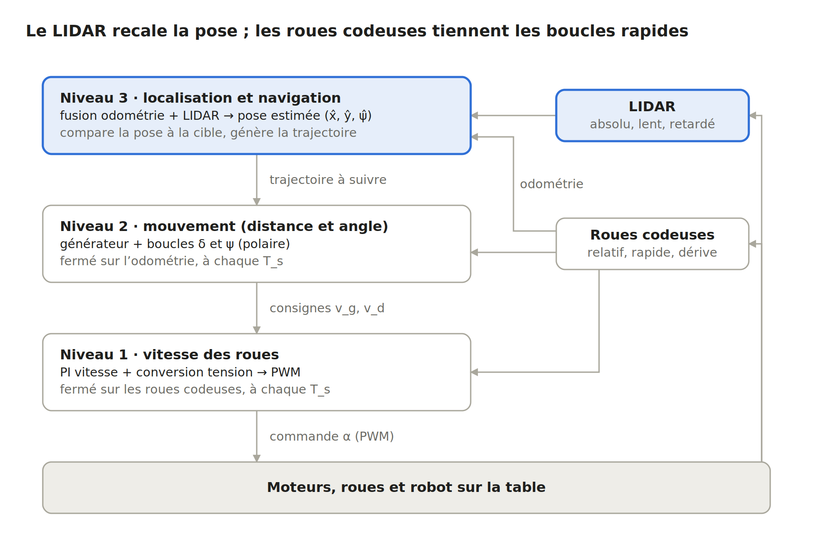
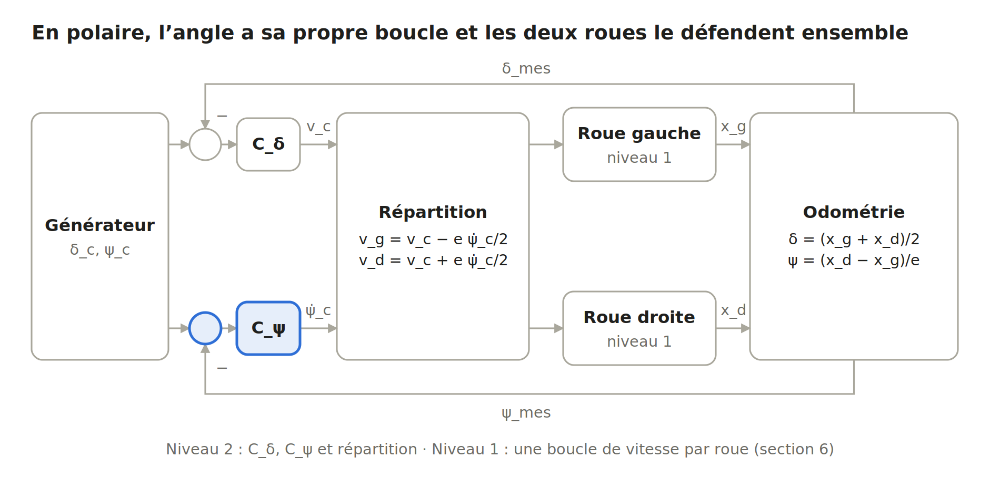
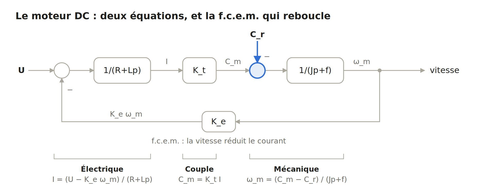
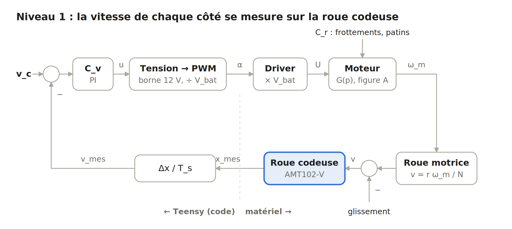
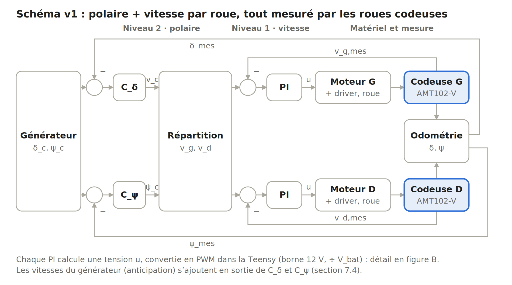
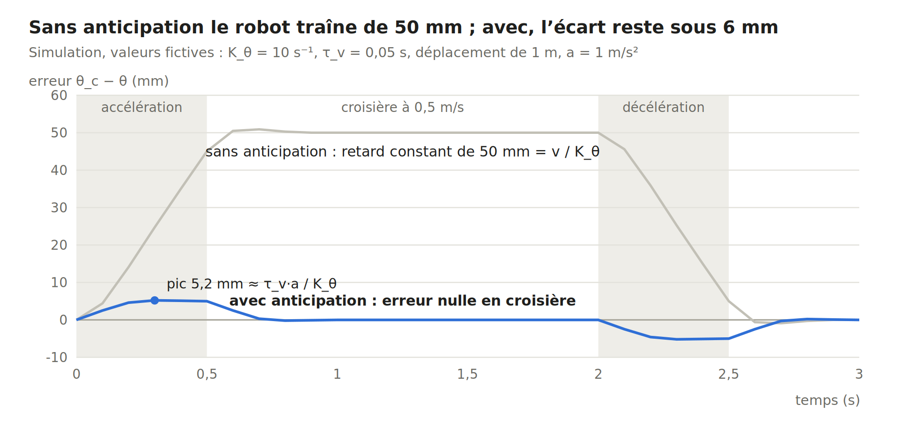

# Asservissement de la base roulante — dossier de conception

## 0. Avant de lire

---

**Disclaimer :** ça peut paraître overkill, et ça l'est très certainement, mais au vu de l'ensemble des possibilités et de tout ce que j'ai appris en faisant mes recherches, j'estime pertinent de consigner tout ça dans un document à mi-chemin entre le document technique et le cours. Pour toute information pratique à la réalisation du projet, il y aura un livrable beaucoup plus concis envoyé à chaque équipe (méca et info).

Sinon, prenez-vous un thé et installez-vous, car bon dieu c'est long (faites au moins semblant, j'ai mis un peu de mon âme dans ce doc et dans mes calculs).

Btw, il peut être pertinent de donner directement le doc à Claude et de spécifier ce que vous devez en tirer si vous avez la flemme.

---

Ce document retrace l'ensemble du processus de réflexion et de conception de l'asservissement de la base roulante.

Voici la convention de traçabilité pour suivre l'avancement de cette documentation :

- **H** : hypothèse non démontrée
- **D** : décision prise
- **Q** : information manquante (liste en section 11)
- **E** : erreur relevée dans une version précédente (liste en section 12)
- **R** : exigence électrique (section 9)

‼️ Toute partie théorique permettant de démontrer l'obtention des résultats est skipable, et sera signalée comme telle. ‼️

Quand une hypothèse tombe (ou n'est plus valide pour une utilisation différente), il est pertinent de chercher son numéro dans le document pour retrouver tout ce qui en dépend.

**Plan du livrable :**

| Partie | Sections | Contenu |
| --- | --- | --- |
| Contexte | 1 à 3 | Besoin, matériel, notations |
| Conception | 4 à 7 | Architecture, modèle du moteur, schéma bloc et code, réglage des correcteurs |
| Mise en œuvre | 8 à 10 | Identification expérimentale, exigences électriques, spécifications à collecter |
| Suivi | 11 à 14 | Points ouverts, revue critique, feuille de route, références |

## 1. Besoin (skipable)

La base roulante doit amener le robot à différentes positions et orientations données, de manière répétable.

La grandeur finale à maîtriser est donc la position du châssis (x, y, ψ).

## 2. Matériel de la base roulante (merci Claude pour le suivi)

| Élément | Référence connue | Statut | Ce qui manque |
| --- | --- | --- | --- |
| Calculateur | Teensy 4.1 | Confirmé | Période de boucle prévue (Q8) |
| Moteurs roues (×2) | Faulhaber 3242G012CR + réducteur 32GPT 6,6:1, roues en prise directe | Moteur et réducteur confirmés | Codeur au dos du moteur : présence à vérifier (Q11) ; rendement du réducteur (Q1) |
| Drivers | Ponts MOSFET, commande PWM + DIR | Référence inconnue | Absent du BOM actuel ; tension max, fréquence PWM, limitation et mesure de courant (Q3) |
| Codeurs | Same Sky AMT102-V, sur les roues encodeuses | Confirmé | Résolution réglée sur le DIP switch ; sortie 5 V à adapter (R6) ; aucun codeur moteur mentionné (Q11) |
| Roues codeuses | Roues folles suspendues, toujours au contact du sol | Confirmé | Diamètre et entraxe à mesurer (Q2) |
| Batterie | LiPo 4S, marquée « 50C » (à vérifier) | 4S confirmé | 14,8 V nominal, 16,8 V pleine charge ; capacité (mAh) et tension mini sous charge à relever (Q7) |
| LIDAR | SICK TiM561-2050101 | Choisi | Hors asservissement bas niveau : sert à la localisation et l'évitement |
| Appuis | Patins en téflon, hauteur réglable par entretoise | Confirmé | Frottement de glissement permanent (section 5.5) |

Deux remarques pour l'asservissement :

- On va considérer la batterie uniquement pour sa **tension**, qui baisse au fil du match, avec quelques chutes, notamment quand les moteurs vont démarrer. Normalement, la compensation par V_bat absorbera ça (section 6.4).
- les autres sous-systèmes (ascenseur, pompe, lanceur) ne seront considérés que par leurs appels de courant sur la batterie.

## 3. Notations, grandeurs et unités (skipable)

Petite introduction des notations et conventions utilisées pour la résolution analytique.

Minuscule = grandeur temporelle, majuscule = transformée de Laplace (u(t) → U(p)).

Toutes les grandeurs mécaniques du modèle sont ramenées à l'**arbre moteur** (D0), sauf mention contraire, afin de simplifier l'ensemble de l'étude dynamique.

| Symbole | Grandeur | Unité |
| --- | --- | --- |
| α | Rapport cyclique signé de la PWM (le signe = DIR) | sans unité, dans [−1 ; 1] |
| V_bat | Tension batterie mesurée | V |
| u | Tension moyenne appliquée au moteur, u = α · V_bat | V |
| i | Courant moteur | A |
| R, L | Résistance et inductance de l'induit | Ω, H |
| K_e, K_t | Constante de f.c.e.m. et constante de couple (égales en SI) | V·s/rad, N·m/A |
| J | Inertie totale ramenée à l'arbre moteur | kg·m² |
| f | Frottement visqueux équivalent | N·m·s/rad |
| C_r | Couple résistant ramené à l'arbre moteur | N·m |
| ω_m, θ_m | Vitesse et angle de l'arbre moteur | rad/s, rad |
| N | Rapport de réduction, ω_roue = ω_m / N | sans unité |
| r | Rayon de la roue motrice | m |
| v, x | Vitesse et abscisse linéaires de la roue au sol, v = r · ω_m / N | m/s, m |
| M | Masse du robot | kg |
| T_s | Période d'échantillonnage de la boucle | s |
| N_c | Comptes par tour après décodage quadrature ×4 | comptes/tour |
| δ, ψ | Distance parcourue par le centre du robot et orientation | m, rad |
| v_g, v_d | Vitesses au sol des côtés gauche et droit | m/s |
| e | Entraxe des roues codeuses | m |
| d_c | Diamètre d'une roue codeuse | m |

À noter : le gain du driver est noté **K_drv** et non K_d, pour ne pas le confondre avec le gain dérivé K_D d'un PID.

## 4. Architecture de l'asservissement

Voici le gros du sujet : on établit pas à pas la structure de l'asservissement.

### 4.1 Principe général

Pour rappel, la chaîne d'un moteur à courant continu est :

tension u → courant i → couple K_t·i → vitesse ω → position θ

Chaque flèche est une dynamique (électrique, mécanique, intégration) et chaque grandeur intermédiaire est un endroit où l'on peut fermer une boucle (pour différents tests ou pour faire une autre structure).

**Règle générale :** une boucle ne corrige que ce qu'elle mesure. Si une perturbation entre entre sa commande et sa mesure, la boucle la voit et la rejette. Sinon, elle n'a aucune chance de la détecter.

On ajoute donc une boucle autour d'une grandeur intermédiaire quand une perturbation importante entre à cet endroit, ou quand on veut imposer cette grandeur (par exemple limiter le couple).

Autre point important : une boucle interne doit être nettement plus rapide que la boucle qui l'entoure (ordre de grandeur usuel : 5 à 10 fois). La boucle externe peut alors la voir comme un bloc presque idéal, ce qui garde nos formules valables.

### 4.2 Architecture en cascade position → vitesse

Avec cette structure, le couple résistant (frottements, charge) freine le moteur **avant** que la position ne bouge. La boucle de vitesse, qui est « plus près » du moteur, le détecte et le compense tout de suite. La boucle de position ne fait que corriger ce qui reste.

En gros : la vitesse corrige le freinage, la position corrige l'écart (**D1**).

À savoir que la consigne sera faite en trapèze de vitesse (accélération bornée) pour éviter tout problème de saturation avec une commande en échelon (**D2**). Petit bonus : limiter l'accélération limite aussi le patinage.

### 4.3 Asservissement du moteur en courant ou en tension

Ceci est une grande question qui m'a fait m'arracher les cheveux, mais elle est aussi pertinente pour le reste des sous-systèmes (propulseur, ascenseur).

Pour choisir, trois questions :

1. **Est-ce que j'ai besoin d'imposer le couple** (sachant que le couple = K_t·i) ? Si oui (effort à maîtriser, grosse inertie à accélérer sans casser la transmission), il faut une boucle de courant.
2. **Quelle perturbation je veux rejeter ?** Une boucle de courant rejette ce qui se passe côté électrique (chute de V_bat, f.c.e.m.). Le couple résistant, c'est la boucle de vitesse qui s'en charge.
3. **Est-ce faisable ?** Il faut mesurer i et boucler beaucoup plus vite que τ_e = L/R.

Pour nos Faulhaber, τ_e ≈ 0,11 ms (section 5.6). Une boucle de courant devrait tourner au-delà de 10 kHz : impossible en logiciel sur la Teensy. De plus, le besoin est une vitesse.

Donc on n'a pas trop le choix : on va asservir les moteurs en **TENSION**.

**D3 — Commande en tension (PWM), boucle de vitesse par-dessus, limitation de courant laissée au driver.**

Pour rappel, la chute de V_bat est compensée en divisant la commande par V_bat mesurée.

En ce qui concerne l'ascenseur ou le lanceur, il faut refaire le même raisonnement : la réponse peut être différente (peut-être superflu).

#### Question légitime : comment un moteur est réellement commandé

À chaque période T_s, pour chaque moteur :

1. **Teensy, code** : le PI de vitesse calcule une tension u en volts, bornée à ±12 V, puis convertie en rapport cyclique α = u / V_bat.
2. **Teensy, broches** : une **PWM** de rapport cyclique |α| à 30–40 kHz (timer matériel) et un signal **DIR** pour le sens.
3. **Driver (pont en H)** : pendant la fraction |α| de chaque période, il branche la batterie sur le moteur ; le reste du temps, il court-circuite le moteur (« frein »).
4. **Moteur** : son inductance lisse le hachage, il voit en moyenne U = α·V_bat.
5. **Roue codeuse** : elle mesure le résultat au sol et referme la boucle.

| Choix | Options | Retenu | Pourquoi |
| --- | --- | --- | --- |
| Grandeur commandée | Tension ou courant | Tension | Boucle de courant impossible à cette vitesse en logiciel ; on veut une vitesse |
| Interface driver | PWM + DIR, deux PWM, ou « locked anti-phase » | PWM + DIR | En locked anti-phase, le moteur reçoit ±V_bat en permanence : ondulation de courant doublée, mauvais avec 135 µH |
| Phase « off » | Roue libre ou frein | Frein, si le driver le permet | En frein, U = α·V_bat quel que soit le courant : le modèle linéaire est vrai. En roue libre, ça déraille à bas régime |
| Fréquence PWM | 20 kHz ou 30–40 kHz | 30–40 kHz | Ondulation de courant divisée par deux (1,6 A → 0,8 A) |
| Limitation du courant | Driver, code, ou rien | Driver + saturation + détection de blocage | Roue bloquée : 9,4 A pour 2,5 A admissibles ; seul le driver coupe vite un pic |

**Ce que ça impose au driver (Q3)** : entrées PWM + DIR en 3,3 V, PWM ≥ 30 kHz, mode frein, ≥ 10 A crête et 2,5 A continu par voie, tension admissible > 16,8 V, idéalement une limitation de courant.

### 4.4 Couple résistant ≠ glissement

Deux perturbations à ne pas confondre :

- le **couple résistant C_r** (frottements, patins, charge, contact) freine la roue : la mesure le voit, la boucle de vitesse le compense ;
- le **glissement** : la roue motrice tourne mais le robot n'avance pas d'autant. Seul un capteur qui mesure le déplacement réel du robot peut le voir.

Heureux hasard : on a des roues codeuses folles (4.5), donc là-dessus, y a pas de souci pour la distinction, sachant qu'en plus, avec l'asserv, l'accélération est limitée par la commande en trapèze de vitesse (D2).

### 4.5 Structure globale de l'asserv et intervention du LIDAR

La position qui compte est celle du robot sur la table. Les roues codeuses la donnent vite mais dérivent (glissements, petites erreurs cumulées ; c'est surtout de là que vient le problème).

L'intérêt du LIDAR est qu'on récupère la donnée sans dérive, mais lentement (15 Hz) et en retard (67 ms). Par construction, une boucle ne réagit pas plus vite que sa mesure. D'où le fait qu'on ne peut pas fermer une boucle rapide sur le LIDAR.

**D5 — Trois niveaux, chacun fermé sur le capteur qui a la bonne cadence :**

- niveau 1, vitesse de chaque roue : roues codeuses, à chaque T_s ;
- niveau 2, distance et angle du robot : roues codeuses, à chaque T_s (4.6) ;
- niveau 3, localisation : fusion odométrie + LIDAR, qui corrige la trajectoire demandée (4.7).



**D9 — Pas de codeur moteur.** Les Faulhaber n'en ont pas ; seules les roues folles en portent (AMT102-V). Les niveaux 1 et 2 se ferment donc tous les deux sur les roues codeuses (même montage que PM-Robotix dans les sources données par Alexandre).

Conséquence : un patinage de roue motrice devient visible et la boucle de vitesse le corrige.

### 4.6 Niveau 2 : asservissement polaire

Deux façons de décrire le même mouvement : par roue (x_g, x_d), ou par robot (distance δ et angle ψ), avec e l'entraxe des roues codeuses :

$$\delta = \frac{x_g + x_d}{2} \qquad \psi = \frac{x_d - x_g}{e}$$

**D8 — On asservit δ et ψ (polaire), pas chaque roue.** **Pourquoi** :

- en asservissant chaque roue, personne ne surveille le cap : si une roue est freinée, le robot tourne et rien ne le ramène dans l'axe. Or 1° d'erreur d'angle, c'est environ 17 mm d'écart latéral après 1 m
- en polaire, l'erreur d'angle apparaît tout de suite et les deux roues corrigent ensemble
- on peut régler l'angle plus raide que la distance
- les mouvements d'un match (« tourner de α », « avancer de d ») s'écrivent directement
- RCVA et PM-Robotix font pareil, et RCVA dit avoir nettement gagné en passant au polaire (cf. les sources en bas du livrable).

Les correcteurs C_δ et C_ψ sortent une vitesse d'avance v_c et une vitesse de rotation ψ̇_c, réparties sur les roues :

$$v_{g,c} = v_c - \frac{e}{2}\,\dot{\psi}_c \qquad v_{d,c} = v_c + \frac{e}{2}\,\dot{\psi}_c$$



**Combien de correcteurs ?** (on peut remercier Lucas, Eliotte et Théophile, qui ont évité un nombre beaucoup plus élevé) Quatre : deux PI de vitesse (un par roue) et deux P en polaire. Dans le code, c'est une seule classe instanciée quatre fois.

**Et les courbes ?** Un suivi de trajectoire en (x, y, ψ) se branche au-dessus, en donnant directement v_c et ψ̇_c à la même répartition.

Deux étapes intermédiaires : orienter le robot vers la cible à chaque période (cf. RCVA), ou enchaîner les points sans s'arrêter (cf. PM-Robotix).

Pour préparer ce passage, la répartition doit accepter (v_c, ψ̇_c) de n'importe quelle source, et le générateur doit être un module séparé. On décidera en chronométrant de vrais déplacements (il faudrait vraiment qu'on pose les choses à plat à plusieurs).

### 4.7 Niveau 3 : recaler la pose avec le LIDAR

Le niveau 3 envoie à la Teensy une correction de pose.

=> ‼️ Les boucles ne doivent jamais voir ce saut, sinon à-coup et patinage. ‼️

**D6 — Deux grandeurs séparées dans la Teensy, deux commandes :**

- les boucles utilisent les incréments odométriques du mouvement en cours, qu'on ne touche jamais ;
- la pose absolue (x̂, ŷ, ψ̂) ne sert qu'au niveau 3 : c'est elle qu'on corrige ;
- `CORRECT_POSE(t_m, X, Y, Theta, k)` en match : correction partielle (k entre 0 et 1, pour filtrer le bruit du LIDAR) et horodatée, car la mesure date du balayage
- `RESET_POSE(X, Y, Theta)` uniquement robot à l'arrêt (départ, calage contre une bordure).

$$\hat{P}(t) \leftarrow \hat{P}(t) + k\,\big(P_{LIDAR}(t_m) - \hat{P}(t_m)\big)$$

Pourquoi l'horodatage (on va rester tatillon) : à 0,5 m/s, 50 ms de retard vont entraîner 25 mm d'erreur créée par le recalage lui-même (un peu chiant).

## 5. Modèle du moteur (ultra skipable)

Ce qu'il faut retenir : vu de l'extérieur, une roue = un **premier ordre tension → vitesse**, avec le couple résistant en seconde entrée. Le reste de la section démontre les résultats ; c'est vraiment du programme de PSI, mais bon, le process a été fait afin de vérifier qu'on peut bien assimiler ça à des boîtes idéales.

### 5.1 Hypothèses

- **H1** : τ_e = L/R ≪ τ_m, on néglige L (vérifiée en 5.6).
- **H2** : transmission rigide, sans jeu, de rendement η.
- **H3** : pas de régulation de courant rapide dans le driver (Q3).
- **H4** : en ligne droite, chaque roue entraîne la moitié de la masse.
- **H5** : driver idéal, U = α·V_bat (vrai en mode frein, 4.3).

### 5.2 Équations

$$u = R\,i + L\,\frac{di}{dt} + K_e\,\omega_m \qquad J\,\frac{d\omega_m}{dt} = K_t\,i - f\,\omega_m - C_r$$

$$J = J_{\text{moteur}} + J_{\text{réducteur}} + \frac{J_{\text{roue}}}{N^2} + \frac{M}{2}\,\frac{r^2}{N^2}$$

Le terme dominant de J, c'est la masse du robot : d'où l'identification au sol (section 8).

### 5.3 Fonction de transfert

On remplace I = (U − K_e·Ω_m) / R dans l'équation mécanique et on regroupe :

$$\Omega_m = \frac{K_m}{1+\tau_m p}\,U - \frac{K_c}{1+\tau_m p}\,C_r \qquad K_m = \frac{K_t}{R f + K_t K_e} \qquad K_c = \frac{R}{R f + K_t K_e} \qquad \tau_m = \frac{R J}{R f + K_t K_e}$$

Mesuré au sol (D9), on multiplie par r / N : v = (r / N)·Ω_m.

### 5.4 Driver et batterie

U = α·V_bat. Sans compensation, le gain de boucle varie avec la batterie (16,8 V → environ 14 V, plus les chutes quand la pompe ou le lanceur démarrent). Avec α = u / V_bat, K_drv = 1 et la Teensy raisonne directement en volts. Il faut juste mesurer V_bat sur une entrée analogique via un pont diviseur (R7).

### 5.5 Ce que le modèle linéaire ignore

Frottement sec et patins en téflon (zone morte : le moteur ne démarre qu'au-dessus d'un seuil de tension), saturation, jeu, quantification des codeurs à basse vitesse. On les traite en essai (section 8) et dans le code (section 6.4).

### 5.6 Valeurs : Faulhaber 3242G012CR + réducteur 32GPT 6,6:1

Source : [fiche Faulhaber série 3242 ... CR](https://www.im-tek.com/docs/faulhaber-3242g036cr-dc-micromotor-285952.pdf) et rapport méca 2024-25.

| Grandeur | Valeur | En SI |
| --- | --- | --- |
| Tension nominale | 12 V | 12 V |
| Résistance R | 1,27 Ω | 1,27 Ω |
| Inductance L | 135 µH | 1,35·10⁻⁴ H |
| Constante de couple k_M | 20,6 mN·m/A | K_t = 0,0206 N·m/A |
| Constante de f.c.e.m. k_E | 2,15 mV/(tr/min) | K_e = 0,0205 V·s/rad |
| Inertie du rotor | 25 g·cm² | 2,5·10⁻⁶ kg·m² |
| Constante de temps mécanique (moteur seul) | 7,5 ms | 7,5·10⁻³ s |
| Vitesse à vide à 12 V / max | 5 200 / 6 000 tr/min | 545 / 628 rad/s |
| Couple de frottement | 4,8 mN·m | 4,8·10⁻³ N·m |
| Couple et courant nominaux | 40 mN·m, 2,5 A | — |
| Réduction N | 6,6 (prise directe sur la roue) | — |

Ce que ça implique :

- **H1 validée** : τ_e ≈ 0,11 ms, 70 fois plus court que τ_m (et K_e ≈ K_t, la fiche est cohérente) ;
- **12 V sur une 4S** : la saturation borne à 12 V, ce qui protège aussi les 6 000 tr/min max ;
- **driver** : environ 9,4 A roue bloquée (12 / 1,27), 2,5 A en continu ;
- **PWM** : ondulation de courant ≈ V_bat / (4·L·f), soit 1,6 A à 20 kHz et 0,8 A à 40 kHz, d'où 30–40 kHz ;
- **à la roue** : environ 790 tr/min à vide sous 12 V, couple de blocage ≈ 1,2·η N·m, et l'inertie du robot est divisée par N² ≈ 43,6 une fois ramenée au moteur.

Il manque r, M et η pour finir le chiffrage, il est donc nécessaire de faire un banc de test.

## 6. Schéma bloc et code

Trois schémas, du plus petit au plus grand : le moteur seul, la boucle de vitesse d'une roue, puis le robot entier. Puis le code exécuté par la Teensy.

### 6.1 Le moteur (skipable)

Un schéma bloc, c'est une équation dessinée : chaque sommateur est une addition qui existe dans une équation, chaque bloc une multiplication. Les équations de la section 5.2 donnent directement :



- électrique : I = (U − K_e·Ω_m) / (R + Lp) ;
- couple : C_m = K_t·I ;
- mécanique : Ω_m = (C_m − C_r) / (Jp + f). C'est ici, et seulement ici, que C_r entre (E1) ;
- la f.c.e.m. K_e·Ω_m reboucle d'elle-même, par la physique du moteur, sans capteur.

Réduit (section 5.3), tout ce dessin vaut **G(p) = K_m / (1 + τ_m·p).**

### 6.2 Boucle de vitesse d'une roue (niveau 1)



Dans le sens des flèches :

- le PI compare v_c à v_mes et sort une tension u ;
- « Tension → PWM » : on borne u à ±12 V (un limiteur, pour protéger le moteur), puis on calcule α = u / V_bat. Exemple : 12 V avec une batterie à 16 V donne α = 75 %, avec 14 V α = 86 %. Ce bloc est du code (6.4) ;
- le driver multiplie par V_bat, le moteur fait G(p), la roue donne v = r·ω_m / N ;
- le glissement se retranche au contact roue-sol ;
- la roue codeuse mesure le déplacement x, la Teensy en déduit v_mes = Δx / T_s.

Comme on mesure au sol, la boucle rejette à la fois C_r et le glissement (cf. les explications avant sur le principe du bouclage).

### 6.3 Le robot complet



De gauche à droite, on descend dans les niveaux : générateur → C_δ et C_ψ → répartition → deux PI → moteurs. Les boucles courtes (v_g,mes, v_d,mes) ferment le niveau 1, les longues (δ_mes, ψ_mes) le niveau 2. Le recalage LIDAR agit sur la trajectoire demandée au générateur (4.7), jamais directement sur ces boucles.

### 6.4 Ce que la Teensy exécute

Petit avantage de faire relire le truc par Claude et de donner l'ensemble de mes sources, j'ai déjà un brouillon du code pour le pôle info. Voyez ça comme un coup de pouce, je suis incapable de faire ce que vous faites, de gros bisous.

À chaque période T_s (interruption timer), dans cet ordre :

```cpp
// 1. Mesure (décodeurs de quadrature matériels, R5)
long ng = enc_g.read(), nd = enc_d.read();
float dxg = (ng - ng_prec) * K_ENC;   // K_ENC = pi * d_c / N_c  [m/compte]
float dxd = (nd - nd_prec) * K_ENC;
ng_prec = ng;  nd_prec = nd;
float vg_mes = dxg / Ts,  vd_mes = dxd / Ts;           // niveau 1
float dDelta = (dxg + dxd) / 2,  dPsi = (dxd - dxg) / E;
delta_mes += dDelta;  psi_mes += dPsi;                 // mouvement en cours, jamais recalé
pose_x += dDelta * cos(pose_psi + dPsi / 2);           // pose absolue, recalable (4.7)
pose_y += dDelta * sin(pose_psi + dPsi / 2);
pose_psi += dPsi;

// 2. Consignes : profil trapézoïdal (D2)
gen.step(Ts);   // donne delta_c, v_ff, psi_c, w_ff

// 3. Niveau 2 : polaire, P + anticipation (D4, D8)
float v_c = gen.v_ff + K_DELTA * (gen.delta_c - delta_mes);
float w_c = gen.w_ff + K_PSI   * (gen.psi_c   - psi_mes);

// 4. Répartition
float vg_c = v_c - E / 2 * w_c;
float vd_c = v_c + E / 2 * w_c;

// 5. Niveau 1 : PI vitesse, puis tension -> PWM
commander(MOT_G, pi_g.update(vg_c - vg_mes, Ts));
commander(MOT_D, pi_d.update(vd_c - vd_mes, Ts));

// 6. Sécurités
surveiller_blocage();  surveiller_bau();
```

Les deux fonctions qui font tout le travail moteur :

```cpp
float PI::update(float e, float Ts) {
  float u = Kp * e + integ;
  if (u > U_MAX)       u = U_MAX;            // saturation à +12 V
  else if (u < -U_MAX) u = -U_MAX;           // ... et -12 V
  else integ += Ki * e * Ts;                 // anti-emballement : on n'intègre que hors saturation
  return u;
}

void commander(Moteur m, float u) {
  float alpha = u / vbat_mesuree();          // compensation batterie (D3)
  alpha = constrain(alpha, -1.0, 1.0);
  digitalWrite(m.dir, alpha >= 0);           // sens
  analogWrite(m.pwm, fabs(alpha) * PWM_MAX); // PWM 30-40 kHz, timer matériel (R4)
}
```

Et autour (vraiment nécessaire) :

- **Détection de blocage** : si |u| dépasse un seuil alors que le robot avance ou tourne moins vite qu'un seuil, pendant plus d'une durée donnée, on met commande et intégrateurs à zéro et on remonte « BLOQUÉ » au niveau 3. Sans ça, la roue bloquée consommera aux alentours de 9,4 A en continu dans le moteur (E19). Le même mécanisme sert au calage volontaire contre une bordure (si on l'implémente), suivi d'un `RESET_POSE`.
- **BAU** : la Teensy lit la tension en aval du BAU. Si elle tombe, commande et intégrateurs à zéro (R2), sinon le robot bondit au réarmement.
- **Interface avec le niveau 3** (Q10) : la Teensy remonte environ toutes les 100 ms la pose (paramétrée avec le bon Serial.begin, bien sûr), son statut (bloqué, arrêté, au repos, en mouvement) et les vitesses. L'idée est qu'elle reçoit les mouvements à faire, `CORRECT_POSE` et `RESET_POSE`.

**Paramètres à fixer (je ff, j'ai besoin d'aide) :**

| Paramètre | Valeur | D'où ça vient |
| --- | --- | --- |
| T_s | À choisir ; RCVA tournait à 200 Hz en 2006, la Teensy fera bien mieux | Q8, 7.3 |
| K_ENC = π·d_c / N_c | À mesurer | DIP switch des AMT102-V, diamètre des roues codeuses |
| E (entraxe des roues codeuses) | À mesurer | Q4 |
| U_MAX | 12 V | Fiche moteur (5.6) |
| Fréquence et résolution PWM | 30–40 kHz, environ 12 bits | R4 |
| Kp, Ki des PI de vitesse | Calculés depuis l'identification | 7.1 |
| K_DELTA, K_PSI | Calculés depuis le PI réglé | 7.2 |
| a_max, v_max du générateur | Performances visées | Q5 |
| Seuils de blocage | En essai | 6.4 |

## 7. Réglage des correcteurs

Ce qu'il faut retenir de tout ce blabla :

**un PI en vitesse, un P + anticipation en position.** Pas de PID complet nulle part : le D n'apporte rien sur un premier ordre et amplifie le bruit des codeurs (E6).

Je me permets d'insister, car je suis le mec qui fait des trucs overkill, et honnêtement, pour la commande qu'on a à faire, un correcteur dérivateur (qui est, entre autres, un correcteur à avance de phase) va juste amplifier le bruit. Pour toute personne qui n'est pas d'accord, je propose qu'on fasse sans, et si jamais il s'avère que l'implémenter est nécessaire, on pourra le rajouter en parallèle : la structure est pensée pour. Les démonstrations sont franchement skipables, les formules en bloc servent au code.

On note G(p) = K / (1 + τ·p) la chaîne tension → vitesse au sol, avec K = K_m·r / N, identifiée en section 8. On suppose « Tension → PWM » parfait (K_drv = 1) et on néglige les retards numériques jusqu'en 7.3.

### 7.1 PI de vitesse (niveau 1)

FTBO L_v = C_v·G, et en boucle fermée, le couple résistant est divisé par 1 + L_v. Avec un intégrateur dans C_v, il est même annulé en régime permanent.

PI : C_v = K_p·(1 + T_i·p) / (T_i·p). On choisit T_i = τ (on compense le pôle du moteur), et la boucle fermée devient un premier ordre dont on choisit la rapidité τ_v :

$$T_v(p) = \frac{1}{1+\tau_v p} \qquad K_p = \frac{\tau}{K\,\tau_v} \qquad K_i = \frac{K_p}{\tau}$$

Recette : on identifie K et τ, on choisit τ_v (plus petit = plus nerveux, limité par la saturation et par T_s), et on en déduit K_p et K_i.

### 7.2 P de position (niveau 2, δ et ψ)

Chaque boucle polaire voit T_v puis un intégrateur (vitesse → position). Avec un correcteur P de gain K_θ :

$$L_\theta(p) = \frac{K_\theta}{p\,(1+\tau_v p)} \qquad \omega_0 = \sqrt{\frac{K_\theta}{\tau_v}} \qquad \xi = \frac{1}{2\sqrt{K_\theta\,\tau_v}} \qquad K_\theta \approx \frac{0{,}5}{\tau_v}\ \text{pour}\ \xi = 0{,}7$$

Pas besoin d'intégrateur : le système est déjà de classe 1, donc erreur nulle à l'arrêt. Reste l'erreur de traînage en croisière, que l'anticipation supprime (7.4). Même chose pour δ (K_DELTA) et pour ψ (K_PSI).

### 7.3 Ce que le numérique change

La vitesse est estimée par Δx / T_s (on va discrétiser, quoi), ce qui équivaut à un retard d'environ T_s / 2, plus le temps de calcul. Ces retards mangent de la marge de phase : il faut T_s au moins 10 fois plus petit que τ_v, et vérifier la stabilité avec les vraies valeurs.

### 7.4 L'anticipation (alors là, faut être concentré, svp)

Un correcteur proportionnel (le P sur le schéma bloc) ne demande de la vitesse que s'il voit une erreur. Pour rouler à v, il lui faut donc une erreur permanente v / K_θ.

Exemple : K_θ = 10 s⁻¹ et 0,5 m/s, le robot roule en permanence 5 cm derrière sa consigne.

**Le problème.** Le correcteur réagit toujours après coup : il faut d'abord que le robot soit en retard pour qu'il lui demande d'avancer. C'est la **rétroaction** : elle corrige ce qui s'est déjà passé.

**L'idée.** C'est le générateur de trajectoire qui calcule le trapèze de vitesse. Il sait donc, à chaque instant, à quelle vitesse le robot *doit* rouler. Au lieu d'attendre que l'erreur apparaisse, on envoie directement cette vitesse prévue à la boucle de vitesse : c'est l'**anticipation** (*feedforward*), notée ω_ff (**D4**). Elle agit sur ce qui va se passer.

La consigne de vitesse devient la somme des deux :

$$\omega_c = \underbrace{\omega_{ff}}_{\text{anticipation}} + \underbrace{K_\theta\,(\theta_c - \theta_{mes})}_{\text{rétroaction}}$$

- **ω_ff** : la vitesse prévue par le générateur. Elle est connue à l'avance et ne dépend d'aucune mesure. C'est elle qui fait avancer le robot.
- **K_θ·(θ_c − θ_mes)** : la correction de ce qui dévie quand même (frottements, patins, retard de la boucle de vitesse). Elle ne fait plus que rattraper les petits écarts.

Analogie (elle est pas de moi, celle-ci, mais elle aide à comprendre le principe) : tu suis une voiture à distance fixe. Sans anticipation, tu accélères seulement quand tu vois l'écart grandir, donc tu es toujours un peu trop loin. Avec anticipation, tu regardes son compteur et tu roules à la même vitesse ; tu ne corriges plus que les petits écarts.

**Résultat** (courbe ci-dessous) : sans anticipation, le robot traîne de 50 mm pendant toute la croisière. Avec, l'erreur est nulle en croisière ; il ne reste qu'un petit écart τ_v·a / K_θ pendant les accélérations, le temps que la boucle de vitesse suive.



Pourquoi pas un intégrateur à la place ? Il devrait d'abord laisser l'erreur s'accumuler, il ajoute du dépassement à l'arrêt et il s'emballe en saturation, donc mauvaise idée.

L'anticipation est hors boucle : elle ne coûte rigoureusement rien en stabilité.

## 8. Identification expérimentale de G(p) (vibe TP de SI, je sais)

On mesure K_m et τ_m par des échelons de tension, robot au sol, en boucle ouverte. Plan de test détaillé : étape 8 de la feuille de route.

1. **Instrumenter.** Enregistrer à la période T_s prévue pour la boucle : temps, α, V_bat mesurée, comptes des deux roues codeuses. La grandeur d'entrée est u = α · V_bat en volts, pas le pourcentage de PWM (E4, E5).
2. **Mesurer la zone morte.** Rampe lente de u depuis 0 jusqu'au démarrage de la roue, dans les deux sens. On note u_0+ et u_0−.
3. **Échelons autour d'un point de fonctionnement.** Partir d'une vitesse déjà stabilisée (u_1 > u_0), puis passer à u_2. Partir de l'arrêt fausserait K_m à cause du frottement sec (E11).
4. **Au sol, robot complet et lesté.** τ_m dépend de la masse ramenée (section 5.2). Sans codeur moteur (D9), un essai roues en l'air ne mesure rien : les roues codeuses ne tournent que si le robot avance. L'identification se fait donc forcément au sol, robot complet (E10).
5. **Calculer.** Vitesse au sol de chaque côté : v ≈ π·d_c·Δn / (N_c·T_s), avec d_c le diamètre de la roue codeuse et Δn le nombre de comptes pendant T_s. Puis :

$$K_m = \frac{v_{2,\infty} - v_{1,\infty}}{u_2 - u_1} \qquad v(\tau_m) = v_{1,\infty} + 0{,}632\,(v_{2,\infty} - v_{1,\infty})$$

6. **Valider.** Répéter à deux autres niveaux et dans l'autre sens. Superposer la réponse simulée du modèle aux mesures. Comparer K_m à r / (N·K_e) et τ_m à la valeur calculée en 5.3.

Petites précautions à prendre : piste dégagée assez longue pour atteindre le régime établi, arrêt automatique au bout d'une durée ou d'une distance fixe, u bornée à la tension admissible du moteur.

Autre remarque sur la résolution : à basse vitesse, Δn est petit et la mesure de vitesse est très quantifiée. Il faudra calculer la vitesse minimale mesurable proprement à partir de N_c et T_s (Q1, Q8).

## 9. Exigences électriques

R1, R3 et R4 viennent de la réunion ; les autres en découlent ou découlent du choix de la Teensy 4.1. Chaque exigence a un essai qui prouve qu'elle est tenue, à reprendre dans le plan de tests.

| # | Exigence | Pourquoi | Vérification |
| --- | --- | --- | --- |
| R1 | Le BAU coupe l'alimentation de puissance des drivers (V_bat), jamais l'alimentation logique de la Teensy ni celle des codeurs | Règlement ; la Teensy garde son état et continue de compter les codeurs | BAU enfoncé, robot poussé à la main : moteurs inertes, comptage codeur qui continue |
| R2 | La Teensy détecte le BAU (mesure de la tension en aval du BAU) et met alors commande et intégrateurs à zéro | Sinon les intégrateurs s'emballent pendant le BAU et le robot bondit au réarmement | BAU pendant un mouvement, puis réarmement : aucun mouvement sans nouvelle consigne |
| R3 | Logique protégée des chutes de tension : convertisseur 5 V dédié dont la plage d'entrée couvre la tension batterie la plus basse sous charge, condensateur de réserve en entrée, masses de puissance et de logique reliées en un seul point | Un redémarrage de la Teensy en plein match arrête tout et perd la pose | Roues bloquées à pleine commande, plus démarrage de la pompe et du lanceur ; 5 V observé à l'oscilloscope ; aucun redémarrage |
| R4 | PWM moteurs au-dessus de 20 kHz, sur des broches reliées à un timer matériel, et acceptée par le driver (Q3) | Inaudible et faible ondulation de courant | Fréquence et rapport cyclique mesurés à l'oscilloscope sur chaque broche |
| R5 | Codeurs lus par les décodeurs de quadrature matériels de la Teensy 4.1 plutôt que par interruptions | Aucun front perdu à vitesse maximale | Roue tournée d'un nombre de tours connu : comptes = tours × N_c, à vitesse lente et rapide |
| R6 | Aucun signal au-dessus de 3,3 V sur une broche de la Teensy (codeurs, drivers, BAU) : adaptation de niveau si un composant sort du 5 V | Les broches de la Teensy 4.1 ne tolèrent pas le 5 V | Tension de chaque signal mesurée avant de le brancher |
| R7 | V_bat mesurée sur une entrée analogique par un pont diviseur filtré, à moins de 3,3 V pour 16,8 V | Compensation D3 | Valeur lue comparée au multimètre sur toute la plage de charge |
| R8 | À la mise sous tension et tant que le programme n'a pas démarré, les drivers restent à l'arrêt (résistances de tirage sur les entrées de commande) | Évite un départ intempestif au démarrage ou au téléversement du programme | Mise sous tension et téléversement, roues au sol : aucun mouvement |
| R9 | Si la Teensy est alimentée par VIN et branchée en USB en même temps, séparer VIN et VUSB comme le prévoit PJRC | Évite de renvoyer le 5 V du robot dans l'ordinateur | Contrôle visuel de la carte |
| R10 | Le LIDAR (9 à 28 V, environ 4 W) est alimenté hors du circuit coupé par le BAU, comme la logique | La localisation continue pendant un arrêt d'urgence ; pas de redémarrage du LIDAR au réarmement | BAU enfoncé : le LIDAR continue d'envoyer ses balayages |

Pour R4 : sur la Teensy 4.x, la résolution de la PWM baisse quand sa fréquence monte, de l'ordre de 12 bits vers 36 kHz selon la documentation PJRC (à vérifier). Deux broches d'un même bloc de timer partagent la même fréquence : on choisit donc les broches des deux moteurs ensemble.

## 10. Spécifications à collecter

Tout ce qu'il faut demander ou mesurer avant de chiffrer le modèle et de câbler. La colonne « Sert à » indique où chaque valeur est utilisée.

Où chercher (helppp please) : fiches techniques Faulhaber (moteur, réducteur et codeur ont chacun la leur), fiche du driver, étiquette de la batterie. Diamètres, entraxe, masse et tension sous charge se mesurent sur le robot.

| Composant | Spécification | Valeur | Sert à | Statut |
| --- | --- | --- | --- | --- |
| Faulhaber | Référence complète : moteur + réducteur + codeur | 3242G012CR + réducteur 32GPT 6,6:1 ; pas de codeur moteur | Tout le reste, Q1 | Obtenue |
| Moteur | Tension nominale (V) | 12 V | Saturation de la commande, §5.4 | Obtenue |
| Moteur | Résistance d'induit R (Ω) | 1,27 Ω | G(p) théorique, §5.3 | Obtenue |
| Moteur | Inductance L (H) | 135 µH | τ_e = L/R, hypothèse H1, §4.3 | Obtenue |
| Moteur | Constante de couple K_t = constante de vitesse K_e (N·m/A) | K_t = 0,0206 N·m/A ; K_e = 0,0205 V·s/rad | G(p) théorique, §5.3 | Obtenue |
| Moteur | Inertie du rotor (kg·m² ou g·cm²) | 25 g·cm² | J, §5.2 | Obtenue |
| Moteur | Courant max continu et courant de démarrage (A) | 2,5 A continu (limite thermique) ; environ 9,4 A au blocage sous 12 V | Choix du driver, fusibles, R3 | Obtenue |
| Moteur | Vitesse à vide (tr/min) | 5 200 tr/min sous 12 V (6 000 tr/min maximum) | Contrôle de K_m après identification, §8 | Obtenue |
| Réducteur | Rapport de réduction N | 6,6 (32GPT 6,6:1) | Conversions arbre moteur → roue, §3 | Obtenue |
| Réducteur | Rendement η et jeu angulaire | | C_r ramené, précision | À demander |
| Réducteur | Couple max admissible en sortie (N·m) | | Limite d'accélération | À demander |
| Codeurs AMT102-V | Résolution par tour, en précisant avant ou après décodage ×4 | AMT102-V : 48 à 2 048 impulsions par tour, réglable par DIP switch (jusqu'à 8 192 comptes/tour après ×4) ; réglage du DIP switch à vérifier par le pôle info, ou comptage des impulsions sur un tour de roue | N_c, vitesse minimale mesurable, §8 | Obtenue |
| Codeurs AMT102-V | Tension d'alimentation et niveau des sorties (V) | 3,6 à 5,5 V ; sortie CMOS à la tension d'alimentation, donc 5 V : adaptation de niveau obligatoire | R6 | Obtenue |
| Codeurs AMT102-V | Fréquence de sortie maximale (kHz) | Vitesse max 15 000 ou 7 500 tr/min selon la résolution choisie | R5 | Obtenue |
| Roues motrices | Diamètre réel, mesuré (mm) | | r, odométrie | À demander |
| Roues motrices | Entraxe (mm) | | Cinématique différentielle, Q6 | À demander |
| Roues codeuses | Existence, diamètre, résolution, entraxe | Oui : roues folles suspendues, AMT102-V ; diamètre et entraxe à mesurer | Niveau 2, Q2 | À demander |
| Driver | Référence et plage de tension (V) | | Compatibilité 4S à 16,8 V, Q3 | À demander |
| Driver | Courant continu et courant crête (A) | | Au moins le courant de démarrage moteur | À demander |
| Driver | Fréquence PWM maximale (kHz) | | R4 | À demander |
| Driver | Niveaux logiques acceptés en entrée (V) | | Commande en 3,3 V, R6 | À demander |
| Driver | Limitation et mesure de courant ; comportement à PWM nulle (roue libre ou frein) | | H3, D3, arrêt du robot | À demander |
| Batterie | Nombre d'éléments et taux de décharge | 4S, 50C (à vérifier) | Plage de V_bat, marge de courant | Obtenue |
| Batterie | Capacité (mAh) | | Autonomie, courant max | À demander |
| Batterie | Tension minimale sous charge, mesurée en essai (V) | | Plage de V_bat, R3, Q7 | À demander |
| Convertisseur 5 V | Plage d'entrée (V) et courant de sortie (A) | | R3 | À demander |
| BAU | Calibre en courant et en tension | | R1 | À demander |
| Teensy 4.1 | Broches retenues : PWM (timer), codeurs (quadrature), mesure V_bat, détection BAU | | R2, R4, R5, R7 | À demander |
| LIDAR | Fréquence de balayage, latence, précision, interface | TiM561-2050101 : 15 Hz, 0,33°, 270°, 0,05 à 10 m, temps de réponse typique 67 ms, Ethernet TCP/IP, 9 à 28 V, 4 W ; précision en match à mesurer | Recalage, Q9 | Obtenue |
| Calculateur niveau 3 | Modèle et liaison avec la Teensy | | Interfaces entre niveaux, Q10 | À demander |
| Robot | Masse en configuration de match (kg) | | J, §5.2 | À demander |

## 11. Points ouverts

Q2, Q6 et Q11 sont tranchées. Les questions restantes conditionnent les valeurs numériques (Q1, Q3, Q4, Q5, Q7), la localisation (Q9, Q10) et le code (Q8).

- [ ] **Q1** — Référence complète des Faulhaber : moteur obtenu (12 V, section 5.6) ; réducteur 32GPT 6,6:1 obtenu (rapport méca 2024-25) ; reste son rendement η sur la fiche, et à vérifier si les moteurs portent un codeur (Q11). Fixe G(p) théorique et la tension max à appliquer.
- [x] **Q2** — Les « roues encodeuses » sont-elles des roues folles d'odométrie séparées ? Si oui : diamètre, résolution, entraxe. Décide quel capteur ferme la boucle de position. Les équipes de référence (RCVA, PM-Robotix, section 14) utilisent des roues folles codeuses. Réponse du rapport méca 2024-25 : oui, roues folles suspendues équipées d'AMT102-V. Restent leur diamètre et leur entraxe à mesurer.
- [ ] **Q3** — Référence du driver : tension max, fréquence PWM, limitation de courant, sortie de mesure de courant. Confirme ou infirme H3 et D3.
- [ ] **Q4** — Masse du robot, rayon des roues motrices, entraxe des roues motrices. Fixe J et la cinématique.
- [ ] **Q5** — Performances visées : vitesse max, accélération max, précision d'arrêt, temps pour atteindre une position. Fixe τ_v et K_θ.
- [x] **Q6** — Asservissement par roue (gauche / droite) ou en distance et angle du robot ? Décidé : polaire (D8, section 4.6), avec passage possible aux trajectoires courbes plus tard. Décide la structure de la boucle externe.
- [ ] **Q7** — Batterie : 4S confirmée, marquage « 50C » relevé. Reste à lire la capacité (mAh) sur l'étiquette et à mesurer la tension mini sous charge pendant un match. Fixe la plage de V_bat.
- [ ] **Q8** — Période de boucle prévue sur la Teensy. Le pôle info avait un asservissement qui tournait mais donnait des résultats médiocres : décision de repartir de zéro (D7), en gardant ses mesures et ses gains comme point de comparaison.
- [ ] **Q9** — LIDAR : SICK TiM561-2050101 retenu (15 Hz, 0,33°, 270°, 0,05 à 10 m, Ethernet). Reste la méthode de localisation (balises, bords de table) et la précision réelle en match. Fixe la cadence et la confiance du recalage.
- [ ] **Q10** — Où tourne le niveau 3 : sur la Teensy, ou sur un calculateur séparé qui reçoit le LIDAR ? Le LIDAR étant en Ethernet, un calculateur séparé type Raspberry Pi est probable. Modèle d'interface chez PM-Robotix : la carte d'asservissement remonte toutes les 100 ms la pose odométrique, son statut (bloqué, arrêté, au repos, en mouvement) et les vitesses des roues. Fixe les interfaces entre niveaux.
- [x] **Q11** — Les Faulhaber ont-ils un codeur au dos ? Un moteur avec codeur a au moins 6 fils, un moteur seul n'en a que 2. Réponse : pas de codeur moteur. Les niveaux 1 et 2 se ferment sur les roues codeuses (D9, section 4.5).

## 12. Revue critique

Erreurs relevées dans les versions précédentes, avec leur source et leur correction.

| # | Ce qui était dit | Problème | Source | Correction |
| --- | --- | --- | --- | --- |
| E1 | Perturbation D(p) sommée entre le driver et G_m | Après le driver, le signal est une tension : un frottement (couple) ne peut pas s'y ajouter | Moteur représenté d'un seul bloc, sans endroit pour un couple | §5.3, §6 : C_r entre K_t·i et la mécanique |
| E2 | Glissement traité comme une perturbation compensée par la boucle | Invisible pour un codeur de roue motrice : c'est une erreur de mesure | Demande initiale mélangeant les deux | §4.4 |
| E3 | Deux capteurs distincts H_e,v et H_e,θ | Un seul codeur mesure un angle ; la vitesse est calculée et retardée d'environ T_s/2 | Schéma pensé en continu, pas en numérique | §6, §7.3 |
| E4 | K_d en série avec un G_m identifié par échelon PWM | Le gain du driver est compté deux fois (l'exemple donnait G_m en rad/s par unité de PWM) | Unité d'entrée de G_m jamais fixée | §5.4, D3 : entrée en volts, K_drv = 1 |
| E5 | Gain du driver constant | u = α·V_bat varie avec la batterie (16,8 → ~14 V) et les appels de courant | Lien batterie / asservissement non fait | §5.4 : compensation par V_bat mesurée |
| E6 | PID en vitesse et en position | Sur un premier ordre, le D n'apporte rien ; la position a déjà un intégrateur, un I en plus dégrade la stabilité | Demande initiale « PID » | §7 : PI vitesse, P + anticipation en position |
| E7 | Consigne de position en échelon | Saturation, emballement de l'intégrateur, patinage | Générateur de trajectoire oublié | §4.2, D2 |
| E8 | Pas de saturation ni d'anti-emballement dans le schéma | Comportement réel très différent du modèle lors des grandes consignes | Mentionné en passant seulement | §5.3, §6.1 |
| E9 | Schéma ASCII | Retours de vitesse et de position emmêlés, boucle interne illisible | Mise en page | §6 refait |
| E10 | Identification roues libres | Donne la dynamique du moteur seul ; τ_m réel dépend de la masse du robot | Inertie ramenée non calculée | §5.2, §8 étape 4 |
| E11 | Échelon depuis l'arrêt | Le frottement sec fausse K_m | Non-linéarité non mentionnée | §8 étapes 2 et 3 |
| E12 | Référence moteur | 3242G012CR et 3242G024CR cités ; un moteur 12 V sur une 4S à 16,8 V n'a pas été relevé | BOM non vérifié | §5.6 : tension bornée à 12 V par la saturation (D3) |
| E13 | Base différentielle évoquée en fin seulement | Asservir chaque roue ou asservir distance et angle du robot : choix structurant non tranché | Portée de la question initiale | §4.6, D8 : polaire retenu |
| E14 | Tension ou courant | Critère de faisabilité absent (mesure de i, τ_e très court des Faulhaber) | Réponse centrée sur l'intuition | §4.3 |
| E15 | Aucun objectif chiffré | Impossible de juger un réglage | Absent du cahier des charges | Q5 |
| E16 | « Roue encodeuse » lue comme un codeur Pololu sur roue motrice | Peut désigner des roues folles d'odométrie, ce qui change le schéma | BOM ambigu | Q2 |
| E17 | Notation K_d pour le driver | Confusion avec le gain dérivé K_D du PID | Notation | §3 : K_drv |
| E18 | Boucle de position fermée sur le codeur | La pose du châssis sur la table n'est jamais mesurée de façon absolue : l'odométrie dérive sans limite | Objectif de la section 1 jamais relié à un capteur absolu (relevé à la relecture) | §4.5, D5 : niveau 3, fusion odométrie + LIDAR |
| E19 | Aucune détection de blocage | Robot bloqué : commande saturée en permanence, moteurs en surintensité, attente infinie | Relevé à la lecture de PM-Robotix | §6.4 |
| E20 | Schéma v0 bâti sur un codeur au dos du moteur | Les Faulhaber n'ont pas de codeur ; seules les roues folles en portent | Hypothèse jamais vérifiée sur le matériel | D9, section 6 en version 1 |
| E21 | Blocs « Saturation » et « ÷ V_bat » sans explication | Schéma illisible : des lignes de code présentées comme des composants | Relevé à la relecture | §6.2 et §6.4, bloc « Tension → PWM » |

## 13. Feuille de route

On avance une étape à la fois ; chaque étape met à jour ce document.

**Où on en est :** étape 1 faite ; étape 2 en cours (spécifications de la section 10, mesures sur la maquette).

1. Remise au propre et revue critique de la discussion précédente (versions 0 et 1 de ce dossier).
2. Collecte des spécifications (section 10) et des réponses Q1 à Q10.
3. Modèle chiffré à partir des fiches techniques : K_m, τ_m, J théoriques.
4. Montage électrique : alimentation, drivers, câblage des codeurs et de la mesure de V_bat sur la Teensy.
5. Mise en place de la visualisation en temps réel (PlotJuggler par liaison USB série), puis identification expérimentale (section 8) et comparaison au modèle théorique.
6. Synthèse des correcteurs : PI vitesse, P + anticipation position, vérification avec les retards numériques.
7. Spécification pour le pôle info : période, équations discrètes, saturations, anti-emballement, générateur de trajectoire, interfaces.
8. Plan de tests et de validation sur table.
9. Schéma bloc final (figure, Mermaid et ASCII) et relecture complète.
10. Plus tard, si la stratégie l'exige : passage aux trajectoires courbes, sur la base du polaire (section 4.6).

## 14. Références

Les deux ressources recommandées par un ancien de l'équipe utilisent la même architecture (cascade vitesse par roue + polaire). On leur doit la détection de blocage, la visualisation et deux pistes pour les courbes.

| Référence | Ce qu'on en retient | Où dans le dossier |
| --- | --- | --- |
| [PM-Robotix et EsialRobotik — Asservissement et architecture (2022)](https://www.pm-robotix.eu/2022/12/07/asservissement-et-architecture-pour-notre-robot-autonome/) | Même architecture que la nôtre (PI vitesse par roue, P polaire au-dessus) ; unités SI en flottant ; décodage matériel des codeurs ; détection de blocage ; visualisation PlotJuggler ; interface avec une carte Linux ; GOTO enchaîné | §4.6, §6.4, Q10, feuille de route |
| [PM-Robotix — Instancier et régler son asservissement](https://www.pm-robotix.eu/2022/12/07/instancier-regler-asservissement-robot-autonome/) | Méthode de réglage, à lire avant l'étape 6 de la feuille de route | Feuille de route |
| [EsialRobotik/asserv_chibios](https://github.com/EsialRobotik/asserv_chibios) | Code public de référence, lié au système temps réel ChibiOS ; portage sur Teensy à vérifier | Spécification pour le pôle info |
| [RCVA — Cours asservissement](https://www.rcva.fr/cours-asservissement/) | Le passage de la position par roue à distance + orientation a nettement amélioré leur asservissement ; roues folles codeuses ; 200 Hz dès 2006 ; orientation asservie vers la cible pour des courbes simples | §4.6, Q2, Q8 |
| [RCVA — Cours de localisation](https://www.rcva.fr/cours-de-localisation/) | À lire pour le niveau 3 | §4.5, Q9 |
| [Fiche Faulhaber série 3242 ... CR](https://www.im-tek.com/docs/faulhaber-3242g036cr-dc-micromotor-285952.pdf) | Caractéristiques du moteur 3242G012CR | §5.6 |
| [Fiche SICK TiM561-2050101 (revendeur)](https://eltra-trade.com/products/sick-tim561-2050101) | Caractéristiques du LIDAR | §2, Q9 |
| [Rapport méca 2024-25 (Notion de l'équipe)](https://davincibot.notion.site/Rapport-M-ca-2024-25-28f23f7517b48168b847fe8744d38da0) | Réducteur 32GPT 6,6:1 en prise directe, roues encodeuses suspendues avec AMT102-V, patins en téflon, LIDAR utilisé pour l'évitement | §2, §4.5, §5.5, §5.6, Q1, Q2, Q11 |

Différence : le cours RCVA, plus ancien, asservit en position avec un PID et sans boucle de vitesse interne. PM-Robotix explique pourquoi ils ont ajouté cette boucle (maîtrise des accélérations), nous, on garde la cascade.
